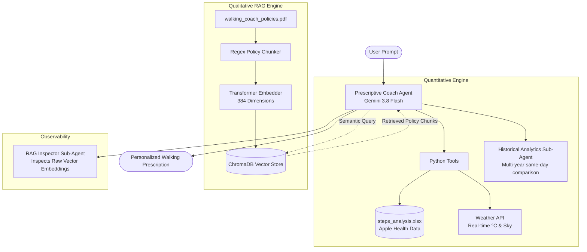

# 🚶‍♂️ Agentic Walking Coach: Multi-Agent RAG Health Assistant

[](https://www.python.org/downloads/)
[](https://github.com/google/adk)
[](https://www.trychroma.com/)
[](https://ai.google.dev/)
[](LICENSE)

An intelligent, multi-agent personal health coaching system powered by **Google Agent Development Kit (ADK)**, **Gemini**, and **ChromaDB Vector RAG**. 

This project bridges **exact quantitative personal health metrics** (extracted from Apple Health) with **evidence-based qualitative policies** (embedded in a local Vector Database) and **real-time outdoor weather conditions** to provide safe, personalized daily walking prescriptions.

---

## 🌟 Key Highlights

* **Hybrid Architecture (Deterministic Analytics + Semantic Vector RAG):**  
  Numbers (exact steps, averages, dates) are computed deterministically via Python/Pandas to eliminate hallucination, while qualitative coaching policies are retrieved semantically via ChromaDB vector embeddings.
* **Apple Health XML Pipeline:**  
  Processes massive multi-year Apple Health exports (`export.xml`, 100k+ records) using iterative streaming XML parsers to generate clean time-series analytics without memory overhead.
* **Vector RAG on Custom Policy PDF:**  
  Health protocols (heat safety, joint recovery, cold limits) live inside an official `walking_coach_policies.pdf`. ChromaDB embeds these policies into a 384-dimensional vector space for semantic retrieval.
* **Multi-Agent Orchestration:**  
  Built using Google's Agent Development Kit (ADK) featuring three specialized agents:
  1. **Prescriptive Walking Coach (Root Agent):** Evaluates momentum, fetches weather, queries the Vector DB, and issues personalized advice.
  2. **Historical Analytics Agent (Sub-Agent):** Calculates same-day benchmarks across historical years (2019–2026).
  3. **RAG Inspector Agent (Sub-Agent):** Dedicated observability agent that exposes raw vector coordinates, dimensions, and similarity scores.
* **Live Environmental Grounding:**  
  Integrates real-time weather data (temperature in °C, sky conditions, humidity) to ensure outdoor recommendations are physically safe.

---

## 🏗️ System Architecture



---

## 🧠 How the Vector RAG Engine Works

Rather than hardcoding coaching rules directly into LLM prompts, this project decouples knowledge from reasoning using **ChromaDB**:

1. **Ingestion & Semantic Chunking:**  
   The system extracts text from `walking_coach_policies.pdf` and isolates each clinical protocol using regex chunking to prevent header/footer noise.
2. **Dense Vector Embeddings:**  
   Each policy chunk is embedded into a **384-dimensional vector space** using SentenceTransformers (`all-MiniLM-L6-v2`).
3. **Semantic Querying:**  
   When the agent observes that conditions are hot ($>20^\circ\text{C}$) or 7-day volume is high ($\ge 8,000$ steps), it formulates semantic queries (e.g., `"hot weather hydration"`, `"high volume joint fatigue"`).
4. **Cosine Similarity Retrieval:**  
   ChromaDB measures geometric cosine distance between the query and stored policies, retrieving only the governing rules needed for the user's specific context.

```
Query: "scorching sunny afternoon" 
  └── Embedding: [-0.041, 0.082, -0.015, ..., 0.054] (384-D)
        └── Nearest Neighbor: Policy 3: High Temperature & Hydration Protocol (Dist: 0.17)
```

---

## 📜 The Knowledge Base (`walking_coach_policies.pdf`)

The agent is governed by 4 strict personal health policies:

| Policy | Protocol | Rule Summary |
| :--- | :--- | :--- |
| **Policy 1** | **Weather Thresholds & Step Limits** | Ideal outdoor walking requires sunny weather and $>10^\circ\text{C}$. If colder or overcast, recommend $\le 5,000$ steps or indoor walking. |
| **Policy 2** | **High Volume & Joint Recovery** | If 7-day average $\ge 8,000$ steps, prompt user to check for joint fatigue/knee soreness. Recommend full rest if body feels fatigued. |
| **Policy 3** | **Heat Safety & Hydration** | If temperature exceeds $20^\circ\text{C}$, mandate active hydration and recommend splitting walks into short "micro-walks". |
| **Policy 4** | **Historical Baseline Discipline** | Prior years' same-day step counts serve strictly as hypothetical indicators; never force the user to overexert to beat past records. |

---

## 🤖 The Multi-Agent Team

### 1. Root Agent: `prescriptive_walking_coach`
Acts as the central coordinator. Gathers data, consults the historical analytics sub-agent, queries ChromaDB for governing policies, and synthesizes the final advice.

### 2. Sub-Agent: `historical_analytics_agent`
Queries the cleaned Apple Health dataset (`steps_analysis.xlsx`) to compare today's calendar date against all recorded prior years (e.g., Oct 15 in 2025, 2024, 2023...) and calculates multi-year averages.

### 3. Sub-Agent: `rag_inspector_agent`
A built-in debugging agent for developers and users. Triggered by queries like *"show me the vector data"*, it retrieves and prints raw vector dimensions, sample floating-point numbers, and policy chunks stored in ChromaDB.

---

## 💬 Sample Interactions

### 1. Daily Walking Prescription (With Weather & Recovery RAG)
> **User:** *"What is my walking prescription for today in New York?"*
>
> **Coach Response:**
> Today is Thursday, October 15, 2026. Here is your personalized breakdown:
>
> 1. **Recent Momentum:** Your 7-day walking average is **8,310 steps** (High Volume).
> 2. **Historical Benchmark:** On October 15 in prior years, you averaged **5,089 steps** (2025: 9,315 steps, 2024: 3,706 steps).
> 3. **Current Weather:** New York is currently **22°C and Sunny**.
> 
> 📋 **Retrieved Health Policies Applied:**
> * *Policy 2 (High Volume & Joint Recovery):* Because your 7-day average exceeds 8,000 steps, take a moment to evaluate any knee or joint fatigue. If your body feels tired, take today as a well-earned rest day.
> * *Policy 3 (Heat & Hydration):* Since ambient temperature is 22°C (>20°C threshold), if you decide to walk, make sure to drink plenty of fluids and divide your target into two 15-minute **micro-walks** rather than one continuous long session!

---

### 2. Inspecting the ChromaDB Vector Store
> **User:** *"Show me the vector data"*
>
> **Coach Response:**
> 🗄️ **ChromaDB Vector Store: `walking_coach_policies` (4 Documents)**
>
> * **`policy_1`**: *Policy 1: Weather Thresholds & Step Limits Protocol...*  
>   `Vector Dimension:` 384 numbers | `Sample:` `[-0.04321, 0.08154, -0.01520, ...]`
> * **`policy_2`**: *Policy 2: High Step Volume & Joint Recovery Protocol...*  
>   `Vector Dimension:` 384 numbers | `Sample:` `[0.02154, -0.07632, 0.11425, ...]`
> * **`policy_3`**: *Policy 3: High Temperature & Hydration Protocol...*  
>   `Vector Dimension:` 384 numbers | `Sample:` `[-0.03841, 0.09123, -0.01431, ...]`
> * **`policy_4`**: *Policy 4: Historical Benchmarks & Physical Limits Protocol...*  
>   `Vector Dimension:` 384 numbers | `Sample:` `[0.01241, -0.04512, 0.08921, ...]`

---

## 🚀 Quickstart & Setup

### 1. Clone the repository
```bash
git clone https://github.com/your-username/agentic-walking-coach-rag.git
cd agentic-walking-coach-rag
```

### 2. Install dependencies
```bash
pip install -r requirements.txt
```

### 3. Set your Gemini API Key
```bash
export GEMINI_API_KEY="your-gemini-api-key"
```

### 4. Launch the Interactive Web UI
```bash
adk web my_agent
```
Open your browser at `http://localhost:8000` to interact with your coach in real time.

---

## 🛠️ Tech Stack

* **Orchestration:** [Google Agent Development Kit (ADK)](https://github.com/google/adk)
* **LLM Engine:** Gemini 3.8 Flash
* **Vector Store & Embeddings:** [ChromaDB](https://www.trychroma.com/) (384-dimensional `all-MiniLM-L6-v2`)
* **Data Processing:** Pandas, OpenPyXL, PyPDF
* **External APIs:** Real-time Weather API (wttr.in)
* **Health Data Source:** Apple HealthKit (`export.xml`)

---

## 📄 License
This project is licensed under the MIT License.
